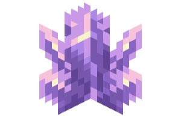

<p align="center">
  
</p>

<h1 align="center">AutoAmethyst</h1>
<p align="center">Automatic amethyst harvesting for RusherHack — fast, simple, and safe for Budding Amethyst.</p>

<p align="center">
  <a href="https://github.com/GarlicRot/AutoAmethyst/actions/workflows/build.yml"></a>
  <a href="https://github.com/GarlicRot/AutoAmethyst/releases/latest"></a>
  
  
</p>

**[Download releases](https://github.com/GarlicRot/AutoAmethyst/releases)** · **[Report a bug](https://github.com/GarlicRot/AutoAmethyst/issues/new/choose)** · **[Changelog](CHANGELOG.md)**

> [!IMPORTANT]
> AutoAmethyst is a **RusherHack plugin**, not a standalone Fabric mod. This release targets **Minecraft 1.21.4**. Other versions are not claimed as supported.

## What it does

AutoAmethyst finds reachable, exposed amethyst growth attached to **Budding Amethyst** and mines it automatically. By default, it only harvests **fully-grown clusters**, letting smaller buds continue growing.

- **Fast handoff:** starts the next target when the previous break is confirmed in the world.
- **Normal block-breaking progression:** uses the current tool and vanilla mining speed, not fake one-tick breaks.
- **Maximum vanilla reach:** up to **4.5 blocks in Survival** or **5.0 in Creative**, while respecting shorter configured reach.
- **Automatic recovery:** retries rejected or unconfirmed breaks with bounded backoff.
- **Two settings:** Harvest and Show Targets. Everything else is automatic.
- **Budding Amethyst is protected:** mining actions are restricted to the four growth blocks; neither Budding Amethyst nor ordinary Amethyst Blocks are targets.

> [!NOTE]
> “Fast” means immediate selection and handoff between confirmed breaks. Actual block destruction still follows the server's mining rules; the plugin does not provide server-bypassing instant mine.

## Install

1. Download `AutoAmethyst-2.0.0.jar` from a **GitHub Release** (after v2.0.0 is published).
2. Close Minecraft. Remove any previous AutoAmethyst JAR from the same `rusherhack/plugins` folder so only one copy loads.
3. Copy the new JAR into your Minecraft instance's `rusherhack/plugins/` folder.
4. Start Minecraft **1.21.4** with a compatible RusherHack installation and enable **AutoAmethyst**.
5. Hold a pickaxe without Silk Touch if you want shards. **Fortune** improves shard yield under vanilla rules.

For **Prism Launcher (Flatpak) on Fedora**, the instance tested during development uses:

```text
~/.var/app/org.prismlauncher.PrismLauncher/data/PrismLauncher/instances/1.21.4/minecraft/rusherhack/plugins/
```

For other launchers or instances, locate that instance's actual Minecraft directory and use its `rusherhack/plugins/` subfolder.

> [!WARNING]
> **All Growth** harvests immature buds too. For a sustainable shard farm, keep the default **Mature Clusters** setting. Do not mine the underlying Budding Amethyst.

## Settings

| Setting | Default | Meaning |
|:--|:--|:--|
| **Harvest** | **Mature Clusters** | Mine fully-grown clusters only, or choose **All Growth** to mine buds as well. |
| **Show Targets** | **On** | Highlight budding blocks (purple), eligible targets (green), and the currently mined block (yellow). |

Reach, scanning, breaking speed, confirmations, and retries are automatic. There are no unnecessary sliders for them.

## Build from source

Requires **Java 21**, the checked-in Gradle wrapper, and a reachable RusherHack API snapshot repository.

```bash
chmod +x ./gradlew                 # Needed only if executable permission was lost
./gradlew updateAccessWidener
./gradlew test build
ls -lh build/libs/
```

Output: `build/libs/AutoAmethyst-2.0.0.jar`.

> [!TIP]
> **Use official GitHub Releases for shared JARs.** The [release workflow](.github/workflows/release.yml) compiles the plugin directly from the tagged source, verifies its version metadata, and publishes a SHA-256 checksum. Run `sha256sum -c SHA256SUMS.txt` in the folder containing both downloaded files to check your copy.

## Troubleshooting

| Symptom | What to check |
|:--|:--|
| Nothing is highlighted | Enable **Show Targets**, make sure you're near a geode and have the module on. |
| Smaller buds are ignored | **Mature Clusters** is intentional; wait for the final growth stage. |
| A cluster is highlighted but not mined | It may be obstructed, too far away, or subject to server permissions. Try an exposed cluster within normal reach. |
| Mining slows or retries | Tool speed, server lag, or server-side mining checks can affect success. |
| The plugin won't load | Confirm Minecraft **1.21.4**, a compatible RusherHack version, the correct plugin directory, and exactly one AutoAmethyst JAR. |
| Gradle reports *Unsupported class file major version 69* | Gradle 8.11 is being run with Java 25. Run the Gradle wrapper using **Java 21**. |

The module yields to manual attack input, item use, menus, and spectator mode. It cannot bypass protected regions or server anti-cheat checks.

## Development and releases

Read **[TESTING.md](TESTING.md)** for regression checks, **[CONTRIBUTING.md](CONTRIBUTING.md)** for contributions, and **[RELEASING.md](RELEASING.md)** for the GitHub-controlled release procedure.

## License

See [LICENSE](LICENSE). The repository currently says **“All rights reserved”**; it does not contain an MIT license grant. Please do not assume the source has an open-source license until the owner explicitly changes the license.
